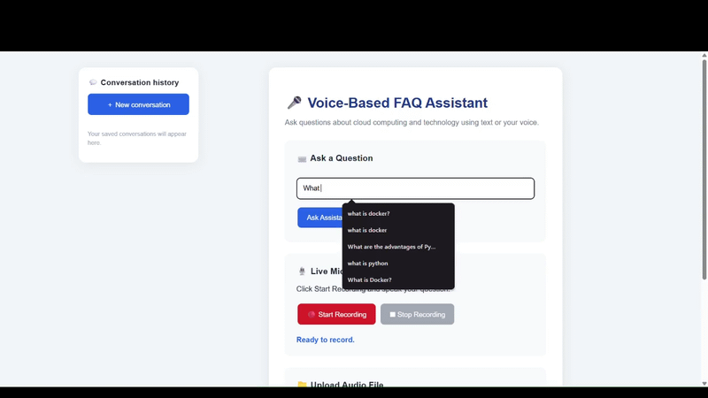
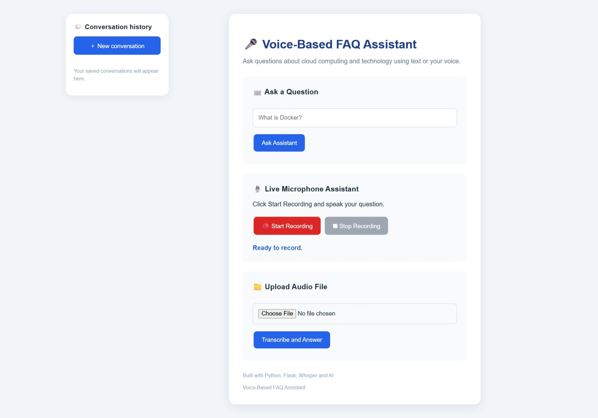

# 🎤 Voice-Based FAQ Assistant

An AI-powered voice assistant built using **Python, Flask, Groq Whisper, and Docker**. Users can ask technology-related questions using text, microphone recordings, or uploaded audio files and receive intelligent responses with optional voice playback.

The application is deployed on **Render** and is accessible through a public website.

## 🌐 Live Demo

🚀 **[Try the Voice-Based FAQ Assistant](https://voice-faq-assistant.onrender.com)**

**GitHub Repository:** https://github.com/1kab1/voice-faq-assistant

> Note: The free Render service may take a short time to respond after inactivity.

## 🎬 Application Demo

### Animated Preview



### Full Demo with Sound

[🎬 Watch the Full Demo with Voice Audio](screenshots/voice-assistant-demo.mp4)

### Application Screenshot



## ✨ Key Features

- **Voice Input:** Record questions directly through the browser microphone.
- **Audio Transcription:** Convert spoken questions into text using Groq's cloud-based Whisper API.
- **Text Questions:** Ask questions directly through a text input.
- **Audio Uploads:** Upload supported audio files for transcription.
- **FAQ Matching:** Retrieve predefined answers using keyword matching.
- **AI-Powered Responses:** Generate answers using GroqCloud when no FAQ match is found.
- **Optional Ollama Fallback:** Support a locally configured Ollama model when available.
- **Text-to-Speech:** Listen to answers using browser speech synthesis.
- **Conversation History:** Store and display conversations using SQLite.
- **Docker Support:** Run the application in a containerized environment.
- **Cloud Deployment:** Publicly deployed on Render.

## 🛠️ Technology Stack

| Component | Technology |
|-----------|------------|
| Backend | Python, Flask |
| Frontend | HTML, CSS, JavaScript |
| Speech-to-Text | Groq Whisper API |
| AI Responses | GroqCloud API |
| FAQ Engine | Python keyword matching |
| Text-to-Speech | Browser Web Speech API |
| Database | SQLite |
| Containerization | Docker |
| Production Server | Gunicorn |
| Cloud Hosting | Render |
| Version Control | Git, GitHub |
| Optional Local AI | Ollama |

## 🏗️ System Architecture

```text
                 USER
                  |
          Web Browser Interface
                  |
        +---------+---------+
        |                   |
    Text Question       Voice Input
        |                   |
        |              Audio Recording
        |                   |
        |              Groq Whisper API
        |                   |
        |              Transcribed Text
        |                   |
        +---------+---------+
                  |
              Flask API
                  |
          FAQ Keyword Matching
                  |
          +-------+-------+
          |               |
       FAQ Match       No Match
          |               |
    Stored Answer     GroqCloud AI
          |               |
          +-------+-------+
                  |
            Final Response
                  |
          SQLite Conversation
                History
                  |
          Browser Interface
                  |
       Optional Voice Playback
```

## ⚙️ How It Works

1. The user submits a question using text, microphone recording, or audio upload.
2. For audio input, the application sends the recording to Groq's Whisper API for speech-to-text transcription.
3. The Flask backend processes the question.
4. The FAQ engine checks for predefined answers in `knowledge_base.py`.
5. If no FAQ match exists, `ai_engine.py` requests an AI-generated response from GroqCloud.
6. If configured, Ollama can serve as an optional local fallback.
7. The question and response are stored in SQLite.
8. The response is displayed in the browser.
9. The user can listen to the response using browser speech synthesis.

## 📁 Project Structure

```text
voice-faq-assistant/
|
|-- app.py
|-- ai_engine.py
|-- answer_engine.py
|-- knowledge_base.py
|-- tts_engine.py
|-- tts_worker.py
|
|-- requirements.txt
|-- Dockerfile
|-- compose.yaml
|-- .dockerignore
|-- .env.example
|-- .gitignore
|
|-- deploy/
|   |-- voice-faq.service
|   |-- monit-voice-faq.conf
|
|-- screenshots/
|   |-- voice-assistant-demo.gif
|   |-- voice-assistant-demo.mp4
|   |-- voice-assistant-full-page.jpeg
|
|-- tests/
|   |-- test_answer_engine.py
|
|-- uploads/
|   |-- .gitkeep
|
|-- README.md
```

**Note:** Some files, such as `tts_engine.py`, `tts_worker.py`, and the Linux deployment configurations, are retained from the original implementation. The hosted application uses browser speech synthesis rather than requiring local speech-generation packages.

## 💻 Run Locally on Windows

### Prerequisites

- Python 3.11 or later
- Git
- A Groq API key
- A modern browser with microphone support

### 1. Clone the Repository

```powershell
git clone https://github.com/1kab1/voice-faq-assistant.git
cd voice-faq-assistant
```

### 2. Create a Virtual Environment

```powershell
python -m venv .venv
.\.venv\Scripts\Activate.ps1
```

### 3. Install Dependencies

```powershell
python -m pip install -r requirements.txt
```

### 4. Configure Environment Variables

Copy the example environment file:

```powershell
Copy-Item .env.example .env
```

Open `.env` and configure:

```env
GROQ_API_KEY=your_groq_api_key_here
```

Get your API key from:

https://console.groq.com/keys

**Never commit `.env` or expose your API key publicly.**

### 5. Run the Application

```powershell
python app.py
```

Open:

http://localhost:5000

## 🐳 Run with Docker

### Prerequisites

- Docker Desktop or Docker Engine
- A configured `.env` file

### 1. Build the Docker Image

```bash
docker build -t voice-faq-assistant .
```

### 2. Run the Container

```bash
docker run --rm -p 5000:5000 \
  --env-file .env \
  --name voice-faq-assistant \
  voice-faq-assistant
```

On Windows PowerShell, use this single-line command instead:

```powershell
docker run --rm -p 5000:5000 --env-file .env --name voice-faq-assistant voice-faq-assistant
```

### 3. Open the Application

Visit:

http://localhost:5000

### 4. Check Application Health

Visit:

http://localhost:5000/health

Or run:

```bash
curl http://localhost:5000/health
```

## ☁️ Deployment on Render

The application is deployed using Render's Docker-based web service.

**Live URL:** https://voice-faq-assistant.onrender.com

### Deployment Configuration

| Setting | Value |
|---------|-------|
| Hosting Platform | Render |
| Service Type | Web Service |
| Runtime | Docker |
| Repository | 1kab1/voice-faq-assistant |
| Branch | main |
| Region | Frankfurt |
| Instance Type | Free |
| Web Server | Gunicorn |
| Environment Variable | GROQ_API_KEY |

### Deployment Steps

1. Push the project to GitHub.
2. Sign in to Render.
3. Create a new Web Service.
4. Connect the GitHub repository.
5. Select the `main` branch.
6. Choose the Docker runtime.
7. Configure the `GROQ_API_KEY` environment variable.
8. Deploy the application.
9. Wait until the deployment status is **Live**.
10. Open the public URL and test the application.

### Memory Optimization

The original application loaded OpenAI Whisper locally, requiring significant memory for the speech recognition model and its dependencies.

To support resource-constrained hosting, speech recognition was migrated to Groq's cloud-based Whisper API.

This optimization:

- Eliminates the need to load a local Whisper model.
- Removes heavyweight local speech recognition dependencies.
- Reduces application memory requirements.
- Simplifies the Docker image.
- Enables deployment on Render's free hosting tier.

## 🧪 Testing

Run the included unit tests:

```bash
python -m unittest discover -s tests -v
```

Manual testing should cover:

- Text-based FAQ questions
- AI-generated fallback responses
- Live microphone recording
- Audio file uploads
- Groq Whisper transcription
- Browser speech playback
- Conversation history
- Docker container startup
- Health endpoint
- Public Render deployment

## 🐧 Optional Linux Deployment

The repository includes example configuration files for running the application as a managed service on a Linux host.

These include:

- `compose.yaml` for Docker Compose.
- `deploy/voice-faq.service` for systemd.
- `deploy/monit-voice-faq.conf` for Monit monitoring.

These files may require adjustments to match the current cloud-transcription implementation and your Linux environment.

For a production Linux deployment, configure HTTPS, authentication, access controls, firewall rules, and persistent storage.

## 🔐 Security Considerations

- API keys are stored in environment variables rather than source code.
- `.env` should remain excluded from Git version control.
- Uploaded audio files are temporarily processed and removed after transcription.
- The application currently uses SQLite for conversation history.
- Conversation history endpoints do not implement per-user authentication or authorization.
- The public deployment should be treated as a demonstration rather than a secure multi-user application.
- Avoid submitting personal, confidential, or sensitive information.
- Authentication and per-user data isolation should be implemented before broader production use.

## ⚠️ Known Limitations

- Render's free instance may spin down during inactivity.
- The first request after inactivity may take longer.
- Groq API usage is subject to rate limits and service availability.
- Cloud speech recognition requires an internet connection.
- SQLite data stored on Render's temporary filesystem may be lost during redeployments or restarts.
- Browser speech synthesis depends on browser and device support.
- The application does not currently provide secure user-specific conversation history.

## 🚀 Future Improvements

- User authentication and authorization
- Per-user conversation history
- Persistent cloud database such as PostgreSQL
- Improved mobile responsiveness
- Additional language support
- Streaming AI responses
- Enhanced error handling and rate limiting
- Automated deployment and integration tests
- Production monitoring and logging

## 👨‍💻 Project Highlights

This project demonstrates practical experience with:

- Python backend development
- REST API integration
- AI and speech recognition services
- Flask web application development
- Docker containerization
- Cloud deployment
- SQL database integration
- Git and GitHub workflows
- Debugging and optimizing cloud applications

## 🔗 Project Links

**Live Application:** https://voice-faq-assistant.onrender.com

**Source Code:** https://github.com/1kab1/voice-faq-assistant

---

Built with Python, Flask, Groq Whisper, Docker, and Render.
